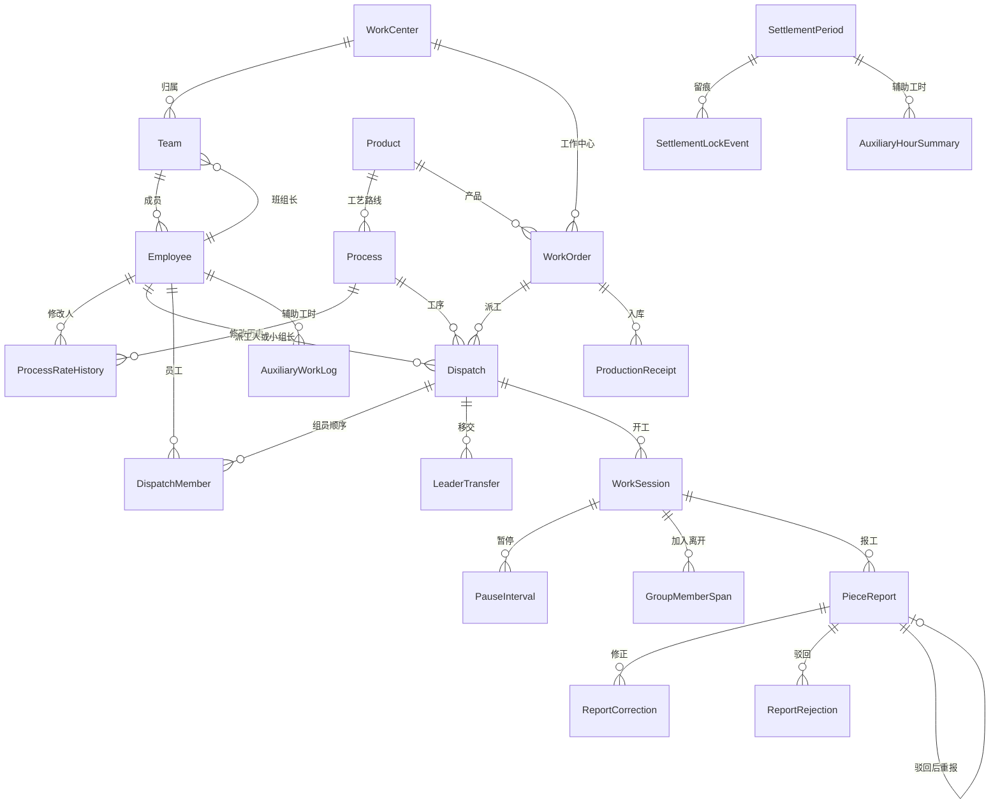

# 数据模型

业务规则只以 [DESIGN.md](DESIGN.md) 为准。这里说明模型怎么拆、哪些约束已经落在模型上，以及哪些口径文档没写死、代码里暂时怎么存。

金额用 `Decimal`，两位小数。时间用带时区的 `datetime`，项目时区是 `Asia/Shanghai`。标准工时按分钟存，实际工时按秒存。完工数量就是合格件数，不另存一个合格数。

## 应用

| 应用 | 模型 | 职责 |
| --- | --- | --- |
| `masterdata` | `Employee` `WorkCenter` `Team` `Product` `Process` `ProcessRateHistory` | 员工、班次、产品工序 |
| `dispatch` | `Dispatch` `DispatchMember` `LeaderTransfer` | 派工、组员顺序、小组长移交 |
| `reporting` | `WorkSession` `PauseInterval` `GroupMemberSpan` `PieceReport` `ReportCorrection` `ReportRejection` | 开工、暂停、报工和审核留痕 |
| `timekeeping` | `AuxiliaryWorkCategory` `AuxiliaryWorkLog` `AuxiliaryWorkCorrection` `AuxiliaryWorkRejection` | 辅助工时。归属日、审核、锁账与报工同一套 |
| `erp` | `WorkOrder` `ProductionReceipt` `ErpSourceMapping` `SyncLog` `SyncState` | 易飞工单和入库只读镜像，字段映射，同步日志 |
| `settlement` | `SettlementPeriod` `SettlementLockEvent` `AuxiliaryHourSummary` | 月结期间、锁账留痕、按员工汇总的已审核辅助工时 |

## 已经卡住的规则

- 员工二维码标识必填且唯一。工牌 NFC 号可空（工牌丢失），有值时唯一。
- 角色是车间工人、班组长、月结结算、工艺人员、系统管理员之一。班组长和整组里的小组长不是一回事：班组长是角色，小组长是整组派工的当前负责人。
- 工作中心必须配置白班、夜班起止。班组四个钟点都空则继承工作中心；要覆盖就必须四个都填。白班和夜班不能重叠，结束时刻不算在本班内。夜班可以跨午夜。
- 工序单价、标准工时修改必须记下修改人、修改时间、旧值和新值。修改人须是工艺人员。历史只追加。
- 易飞工单只区分未结和已关闭，并带工作中心和剩余量。管理后台不能改这张镜像。
- 新派工在工单已关闭时拒绝。单次派工数量必须大于 0，且不能超过工单当前剩余量。工序必须属于工单上的产品。派工由班组长执行。第一期不禁止自派自审。
- 整组按 `sequence` 从 1 连续列出组员，第一位是初始小组长。移交只改当前小组长，不改第一位。尾差以后归这一位。开工后只能移交给当时在组的组员。小组长离开前必须先移交。
- 单人任务可以并行开工。员工待在未完工的整组里时，不能再开别的任务。整组开工默认全员在组，也可以只带一部分，其余由小组长登记加入。
- 暂停必须填写原因，时段不计工时。整组只记一条暂停，全组都扣这段。
- 报工冻结当时的单价和标准工时，并写下归属日、原始完工数量、原始实际秒数。这些字段之后不能改。审核修正、驳回另表保存。
- 归属日看开工时刻，不看报工时刻。跨日夜班整段归开班日，所以月末夜班仍归开班日所在月份。
- 撤回只允许待审核的报工，且必须填写原因。撤回后可以重新开工再报，那时按新的提交重新冻结单价。
- 驳回后由原报工人改数量重报，沿用首次冻结的单价和标准工时，旧报工和驳回记录都留着。
- 完工数量可以大于派工数量，模型不拦截。
- 同一派工同时只能有一条待审核或已通过的报工。
- 该归属月已锁账时，报工、辅助工时和它们的修正、驳回不能再改。有待审核报工或待审核辅助工时时不能锁账。已撤回、已驳回不挡住锁账，也不计入辅助工时汇总。锁账和解锁都由系统管理员执行。解锁必须留下操作人、时间和原因。
- 锁账时按员工写入 `AuxiliaryHourSummary`：该归属月已审核通过的辅助工时分钟合计。有修正时用修正后的分钟。`unit_price` 和 `amount` 保持空，不参与计算。解锁后清掉这份汇总，再次锁账按当时的已审核记录重写。
- 入库对照看产品上的每一道工序，不只末道工序。工单入库数是有效入库行 `receipt_qty` 之和。每道工序分别给出审核通过数量和全部未撤回报工数量（有修正时用修正后的完工数量）。没有报工的工序也列出，数量为 0。差异 = 报工数量 − 入库数量。

## 文档没写死、模型里暂定的存法

- 单次派工和剩余量比，不把同一工单上未完工的派工加总后再拦截。
- 开工时刻落在白班和夜班的空隙里时，归属日用 Asia/Shanghai 的日历日。空隙怎么算班，文档没有约定。
- 员工没有班组时，归属日用工单工作中心的班次；有班组则用班组的有效班次（覆盖优先）。整组看开工当时那位小组长。
- 反审核只要求该月还没锁账。更高权限文档没指定到某个角色，模型不另造一个。
- 一条派工同时只保留一条有效报工。部分完工分多次报，文档没有约定。

## 辅助工时月结

已审核通过的辅助工时计入月结，按员工和归属月份汇总分钟。第一期不算金额。记录上的单价、金额，以及汇总行上的单价、金额，都是以后扩展用的空字段，锁账和汇总都不读取它们。

归属日和班次名称在开工时按工作中心（或班组覆盖）的白班 / 夜班写下，算法与计件报工相同。

## 入库与逐工序报工

`ProductionReceipt` 是易飞入库行的只读镜像。`ErpSourceMapping` 记下表名和字段怎么对到本地，默认 `verified=False`，说明里标着待核对。同步任务以后按这张表拉取，本期内不写拉取逻辑。

对照由 `work_order_quantity_comparison` 现算，不另存一张结果表。

## 与旧系统对照

旧系统 33 个模型。和 `DESIGN.md` 冲突的不搬过来。

| 旧模型 | v2 | 理由 |
| --- | --- | --- |
| `Employee` | `Employee` | 补了 `code`。工牌拆成 `badge_nfc` 和 `qr_code`。`active` 沿用旧名。班组可空，因为工艺、财务、管理员不一定在班组里 |
| `EmployeeCodeCounter` | 未纳入 | 员工编码手工维护，不另做发号器 |
| `EmployeeCreationRequest` | 未纳入 | 不在一期 |
| `WorkCenter` | `WorkCenter` | 补了 `active`。白班 / 夜班起止是设计要求，旧系统没有这两对钟点 |
| `Team` | `Team` | 补了 `code`、`active`。班组长用员工外键。班次覆盖留在班组上 |
| `TeamShift` `BreakPeriod` | 未采纳 | 设计规定白班 / 夜班配在工作中心，班组只能整段覆盖。一期不扣固定休息 |
| `SystemParameter` | 未纳入 | 旧默认值（允许超派、60 分钟同步、60 秒空闲）和设计冲突 |
| `OperationCategory` `Workstation` | 未纳入 | 一期派工不落到工位，并行规则也不按工序类别限数 |
| `Item` | `Product` | 产品在本系统维护。补了规格、单位、启用。一期不同步品号 |
| `ItemOperation` | `Process` | 补了 `operation_code`。单价和标准工时仍在工序上，改完立即生效 |
| `OperationStandardVersion` | 未采纳 | 设计要的是修改人、时间、旧值、新值，不是按生效日做版本。对应 `ProcessRateHistory` |
| `WorkOrder` | `WorkOrder` | 原有字段不改名。只增加 `erp_key`、单别、计划数量、单位、易飞状态和计划日期。`order_no` 仍是工单号，`synced_at` 仍是最近同步时间 |
| `WorkOrderOperationSnapshot` | 未采纳 | 单价在报工时冻结，不在工单下达时冻结。一期没有下达动作 |
| `WorkOrderErpChangeLog` | 未纳入 | 一期镜像由同步覆盖，没有人工确认 ERP 变更这一步 |
| `WorkAssignment` | `Dispatch` | 单人 / 整组用 `kind`。补了班组、计划日期、备注。超派仍然硬拦截 |
| `WorkAssignmentMember` | `DispatchMember` | 用顺序而不是「负责人」标记。第一位是初始小组长，移交另记 `LeaderTransfer` |
| `TimeSegment` | 未采纳 | 开工、暂停、在组时段已经表达设计里的计时。不自动停表，也不做系统暂停 |
| `WorkReport` | `PieceReport` | 完工数量只有一个口径。修正和驳回另表保存，不覆盖原值 |
| `WorkReportTimeSegment` | 未采纳 | 不把报工和工时段做成一一对应 |
| `WorkReportAllocation` | 未采纳 | 整组金额分配仍是结算计算，本期不做。组员工时在 `GroupMemberSpan` |
| `AuxiliaryWorkCategory` `AuxiliaryWorkLog` | 同名模型 | 纳入一期。归属日和锁账与报工一致。已审核分钟按员工写入 `AuxiliaryHourSummary` |
| `PieceworkSettlement` | `SettlementPeriod` | 按年、月锁账，不是一张结算草稿 |
| `PieceworkSettlementRevision` `PieceworkSettlementDetail` | 未另建 | 计件金额分配还没做。辅助工时先用 `AuxiliaryHourSummary` 记下分钟 |
| `ProductionReceipt` | 同名模型 | 纳入一期，只读。逐工序对照入库数和报工数 |
| `SyncLog` `SyncState` | 同名模型 | 给后续同步任务用。拉取逻辑不在本期 |
| `Terminal` `TerminalSession` `TerminalAction` | 未纳入 | 终端页面和会话协议还没做。认人字段在员工上 |

## 仍待核对或以后再做

- 易飞入库表名、字段名还没对照 9.012。`ErpSourceMapping` 默认未核对。
- 计件工资、整组按工时占比分配和尾差、扣款补贴、Excel 导出、终端页面、易飞拉取任务、并行工时分摊、派工超时提醒，仍不在本期计算或页面里。
- 辅助工时的单价和金额只是空字段，一期不启用。

## 本期故意不做

终端页面、登录和权限、易飞同步拉取、并行工时分摊、完工超出派工时的审核提醒、计件月结工资（含整组分配与尾差）、扣款补贴、Excel 导出、派工超时提醒。这些在对应模块的 TODO 里。
