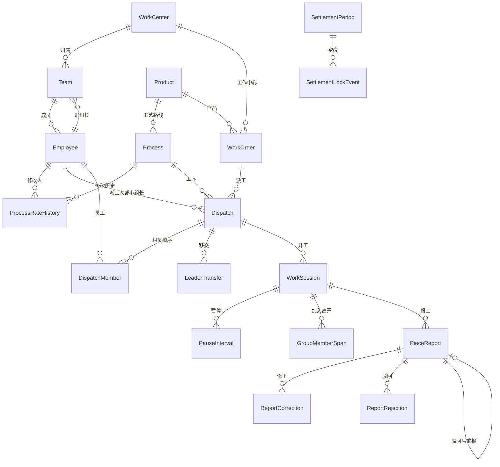

# 数据模型

业务规则只以 [DESIGN.md](DESIGN.md) 为准。这里说明模型怎么拆、哪些约束已经落在模型上，以及哪些口径文档没写死、代码里暂时怎么存。

金额用 `Decimal`，两位小数。时间用带时区的 `datetime`，项目时区是 `Asia/Shanghai`。标准工时按分钟存，实际工时按秒存。完工数量就是合格件数，不另存一个合格数。

## 应用

| 应用 | 模型 | 职责 |
| --- | --- | --- |
| `masterdata` | `Employee` `WorkCenter` `Team` `Product` `Process` `ProcessRateHistory` | 员工、班次、产品工序 |
| `erp` | `WorkOrder` | 易飞工单只读镜像 |
| `dispatch` | `Dispatch` `DispatchMember` `LeaderTransfer` | 派工、组员顺序、小组长移交 |
| `reporting` | `WorkSession` `PauseInterval` `GroupMemberSpan` `PieceReport` `ReportCorrection` `ReportRejection` | 开工、暂停、报工和审核留痕 |
| `settlement` | `SettlementPeriod` `SettlementLockEvent` | 月结期间、锁账和解锁留痕 |

## 已经卡住的规则

- 员工二维码标识必填且唯一。工牌 NFC 号可空（工牌丢失），有值时唯一。
- 角色是车间工人、班组长、月结结算、工艺人员、系统管理员之一。班组长和整组里的小组长不是一回事：班组长是角色，小组长是整组派工的当前负责人。
- 工作中心必须配置白班、夜班起止。班组四个钟点都空则继承工作中心；要覆盖就必须四个都填。白班和夜班不能重叠，结束时刻不算在本班内。夜班可以跨午夜。
- 工序单价、标准工时修改必须记下修改人、修改时间、旧值和新值。修改人须是工艺人员。历史只追加。
- 易飞工单只区分未结和已关闭，并带工作中心和剩余量。管理后台不能改这张镜像。
- 新派工在工单已关闭时拒绝。单次派工数量必须大于 0，且不能超过工单当前剩余量。工序必须属于工单上的产品。派工由班组长执行。第一期不禁止自派自审。
- 整组按 `sequence` 从 1 连续列出组员，第一位是初始小组长。移交只改当前小组长，不改第一位。尾差以后归这一位。开工后只能移交给当时在组的组员。小组长离开前必须先移交。
- 单人任务可以并行开工。员工待在未完工的整组里时，不能再开别的任务。整组开工默认全员在组，也可以只带一部分，其余由小组长登记加入。
- 暂停必须填写原因，时段不计工时。整组只记一条暂停，全组都扣这段。
- 报工冻结当时的单价和标准工时，并写下归属日、原始完工数量、原始实际秒数。这些字段之后不能改。审核修正、驳回另表保存。
- 归属日看开工时刻，不看报工时刻。跨日夜班整段归开班日，所以月末夜班仍归开班日所在月份。
- 撤回只允许待审核的报工，且必须填写原因。撤回后可以重新开工再报，那时按新的提交重新冻结单价。
- 驳回后由原报工人改数量重报，沿用首次冻结的单价和标准工时，旧报工和驳回记录都留着。
- 完工数量可以大于派工数量，模型不拦截。
- 同一派工同时只能有一条待审核或已通过的报工。
- 该归属月已锁账时，报工和它的修正、驳回、开工记录不能再改。有待审核报工时不能锁账。已撤回、已驳回不挡住锁账。锁账和解锁都由系统管理员执行。解锁必须留下操作人、时间和原因。

## 文档没写死、模型里暂定的存法

- 单次派工和剩余量比，不把同一工单上未完工的派工加总后再拦截。
- 开工时刻落在白班和夜班的空隙里时，归属日用 Asia/Shanghai 的日历日。空隙怎么算班，文档没有约定。
- 员工没有班组时，归属日用工单工作中心的班次；有班组则用班组的有效班次（覆盖优先）。整组看开工当时那位小组长。
- 反审核只要求该月还没锁账。更高权限文档没指定到某个角色，模型不另造一个。
- 一条派工同时只保留一条有效报工。部分完工分多次报，文档没有约定。

## 本期故意不做

终端页面、登录和权限、易飞同步任务、并行工时分摊、完工超出派工时的审核提醒、月结工资（含整组按工时占比分配和尾差）、扣款补贴、Excel 导出、派工超时提醒。这些在对应模块的 TODO 里。
